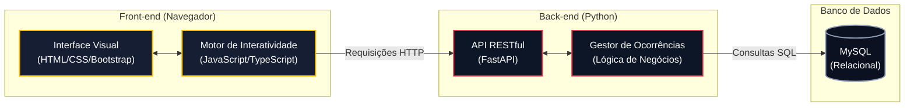

# projeto-hackaton
Plataforma para gestão visual, monitoramento de infraestrutura e respostas a ocorrências do Capim Dourado Shopping.

1. *Documentação inicial do projeto*
Contexto: Um shopping possui instalações, equipamentos, áreas comuns e serviços que precisam funcionar adequadamente durante todo o período de funcionamento. A gestão operacional atual carece de visibilidade centralizada. A identificação de ocorrências e manutenção dependem de comunicação descentralizada (rádios, WhatsApp), dificultando a priorização.

Objetivo: Desenvolver uma plataforma de gestão visual e espacial que permita à administração acompanhar em tempo real as condições dos ambientes, registrar ocorrências por severidade, organizar atividades operacionais e garantir a continuidade dos serviços de forma ágil.

 2. *Proposta e estrutura inicial das telas*

A interface será focada em gestão visual de alto impacto (estilo "SimCity" com visão isométrica):
Tela Principal (Mapa Operacional): Dashboard exibindo a planta baixa do shopping em perspectiva 2.5D. Ocorrências ativas aparecerão como marcadores (pins) interativos sobrepostos nas áreas específicas (ex: Praça de Alimentação, Corredores), com cores indicando a severidade.

Modal de Ocorrências: Interface sobreposta ao mapa contendo um formulário ágil para registrar novos chamados (Título, Localização, Criticidade e Equipe Acionada).

Painel Lateral de Detalhes: Card dinâmico que exibe os dados completos da ocorrência (Status, SLA, Equipe) ao clicar em um pin no mapa.

 3. *Linguagem de programação escolhida*
Front-end: JavaScript (Vanilla) e TypeScript.
Back-end: Python.

 4. *Arquitetura proposta*
Modelo Cliente-Servidor (API RESTful): A aplicação será dividida entre o cliente (navegador) e o servidor. 
   O front-end fará requisições HTTP estáticas e dinâmicas (via *polling* para atualização do mapa em tempo real) para os endpoints expostos pelo back-end. 
   O back-end processará a lógica de negócios, gestão de chamados e controle de estado, persistindo as transações no banco de dados.

 6. *Plataforma e tecnologias adotadas*
Front-end: HTML5, CSS3 avançado (variáveis e transformações 3D), JavaScript para manipulação de DOM/Eventos, e Bootstrap 5.3 para componentização responsiva de UI.
Back-end: FastAPI (Python), garantindo alta performance na prototipação e geração automática da documentação da API (Swagger).
Banco de Dados: MySQL para armazenamento relacional das ocorrências, status e informações dos setores.

7. *Integração da Tecnologia Sorteada (JavaScript/TypeScript)*
A tecnologia sorteada atuará como o motor principal de interatividade do front-end da nossa solução. O JavaScript (Vanilla) está sendo utilizado para:
1. Manipular o DOM de forma dinâmica, calculando coordenadas e renderizando os marcadores visuais (pins) sobre a planta isométrica do shopping.
2. Gerenciar eventos de interface (Mousemove, Clicks) para criar o efeito Parallax 3D e a exibição de modais sem recarregamento da página.
3. Consumir assincronamente os dados da API RESTful (via Fetch API), permitindo o monitoramento contínuo das operações do shopping.
A eventual adoção de TypeScript aplicará tipagem estática aos contratos de dados (como níveis de severidade e status de chamados), garantindo maior confiabilidade durante a integração com o back-end.
